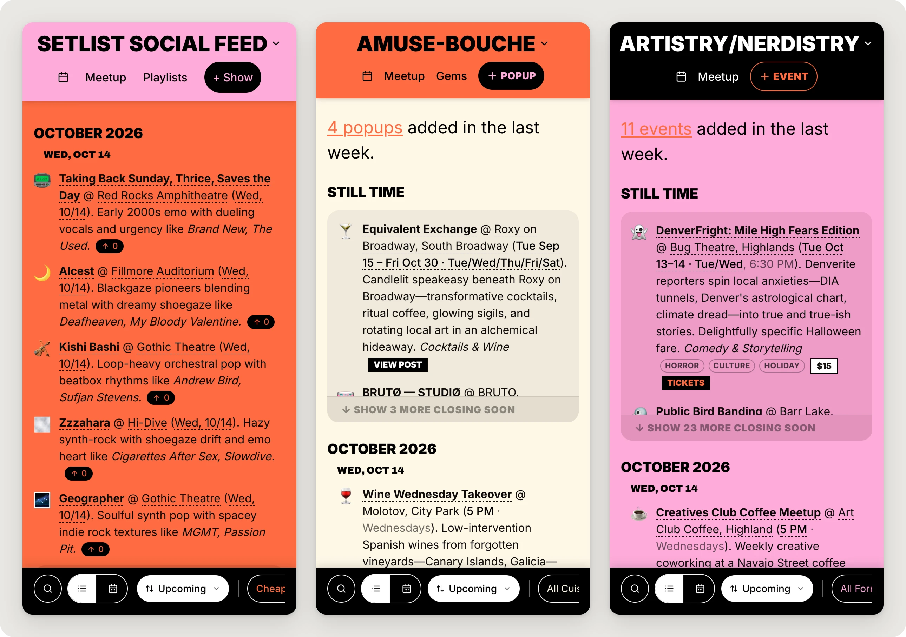
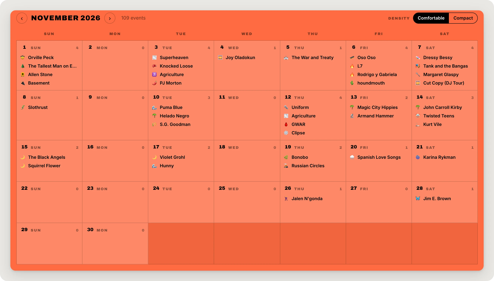
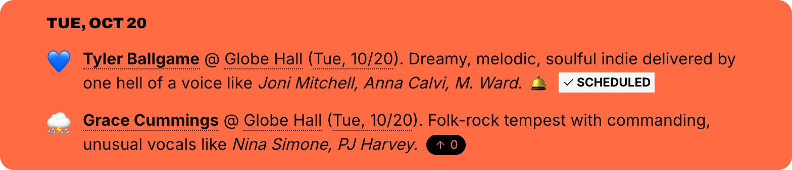
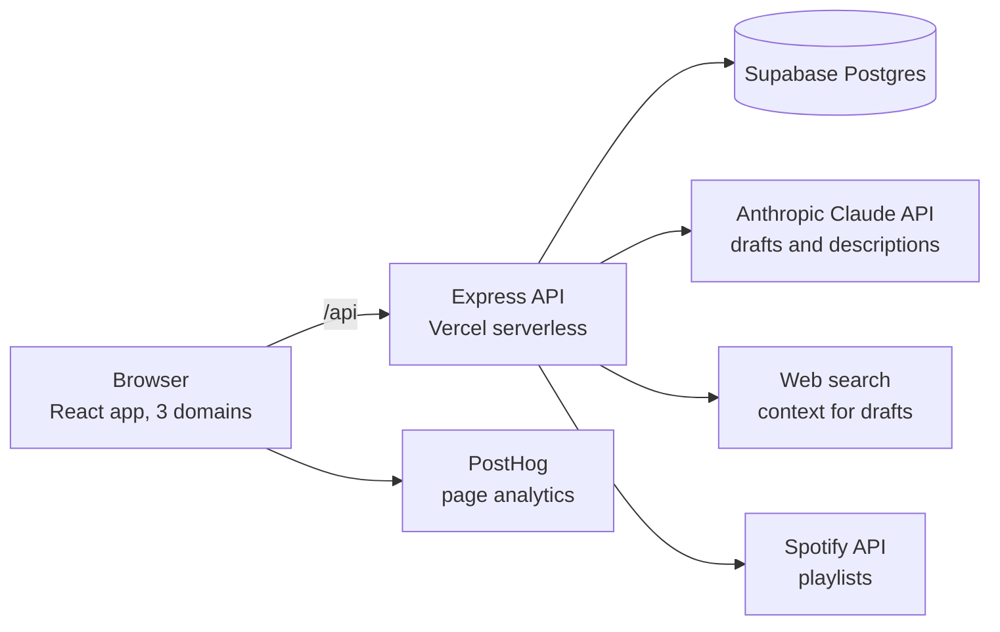

# DenverFeeds

I organize three Denver communities: one around live music, one around food, and one around the arts, sciences and other curious pursuits. Over the past year I've hosted roughly 100 Meetups across them.

DenverFeeds grew out of my own discovery and planning habits. I love finding worthwhile things to do, but I can only host so many outings. And between museum calendars, university talks, venue newsletters, restaurant announcements and Instagram, keeping up with everything I might want to attend had become a project of its own.

I wanted a longer view and a wider lens. Plenty of local curators publish great weekly or weekend roundups, but by the time those arrive, I'm often already booked. I wanted to find things as they're announced—sometimes months ahead—and encounter an indie show, a visiting scientist's talk or an intimate pop-up dinner without having to follow every source separately.

DenverFeeds brings those discoveries together across three distinct but connected feeds. It's broad in subject matter but selective in taste: I curate according to my own eclectic interests, and members can filter that selection to what matters to them, whether they're making plans months out or looking for something this weekend.

On the day I first shared Artistry/Nerdistry with our Meetup group, a member spotted an event, invited others to join him the next day, and two people did. I didn't have to host anything.

| | Setlist Social Feed | Amuse-Bouche Insider | Artistry/Nerdistry Live |
|---|---|---|---|
| **Community** | Live music, mostly indie | Food: pop-ups, supper clubs, special dinners, plus a restaurant guide | Talks, workshops, exhibitions, games and other curious nights out |
| **Live site** | [setlistsocialfeed.com](https://www.setlistsocialfeed.com) | [amuseboucheinsider.com](https://amuseboucheinsider.com) | [artistrynerdistry.com](https://artistrynerdistry.com) |

  

Same platform, three editorial identities. Live production pages, captured October 2026.

## What members can do

- **Browse:** filters, search and a calendar view, plus cues for what was added in the last week and what's still running.
- **Go:** every listing links to the next step: the artist on Spotify, the venue on Maps, the date in Google Calendar, tickets or the original post.
- **Subscribe:** each feed publishes a calendar subscription, so upcoming events show up in your own calendar.
- **Join a Meetup:** on Setlist Social, members upvote shows they'd like me to organize. When I schedule one, the show is marked **Scheduled** and links to our Meetup group, where members RSVP.
- **Add an event, no account needed:** paste a screenshot or a blurb, review the AI-drafted listing, and submit it. Or type it in by hand.

  

Planning beyond this weekend: Setlist Social's November calendar, viewed in mid-October.

## Five product decisions

### 1. Three communities, one recognizable platform

DenverFeeds wasn't originally a three-product strategy. It started in March 2025 as a feed for my music group. It grew as I organized more Meetups and realized that a discovery feed useful for that group could also help my food and arts-and-sciences communities.

The audiences aren't interchangeable. Someone who loves a cheap indie show at Hi-Dive isn't necessarily looking for an intimate, $100-per-person dinner. But I am, and there's meaningful crossover among members who share those interests and know me as the host of all three groups.

So each feed has its own editorial voice, categories, design and event-specific features:
- **Setlist Social** describes every artist in a single "sounds like" line.
- **Amuse-Bouche** leads with price, reservations and whether something sells out.
- **Artistry/Nerdistry** sorts by format and topic, like *Talks & Lectures* × *Astronomy*.

All three keep a family resemblance, link to each other, and run on one shared platform.

The goal wasn't to make three unrelated products, or to flatten them into one generic Denver events feed. It was to make each useful to its particular community without losing what connects them. The cost is that three voices take more curation than one, and every feature has to be built either for all three or deliberately for just one.

### 2. Upvotes are enthusiasm, not a commitment to attend

From the start, Setlist Social has let members upvote concerts they'd like me to organize as Meetups. I hoped those votes would help me prioritize shows the community genuinely wanted to attend. When I do host a show, I mark it Scheduled, and the vote button gives way to a link to our Meetup group, where members RSVP.

  

The votes influenced my hosting decisions at first, but the signal wasn't as reliable as I'd hoped. People voted for bands they loved even when they had scheduling conflicts or hadn't budgeted for tickets. Actual RSVPs were repeatedly lower than the votes suggested. And only a small part of the community voted, so the results skewed toward the most active participants.

The lesson wasn't that voting is useless. It was that **liking an idea, being available to act on it, and representing the wider community are three different things**. I'd like to revisit the experiment with that distinction in mind.

### 3. Frictionless contribution hasn't meant more contribution

I deliberately kept event submission account-free. Then I added AI-assisted parsing, so someone could turn a screenshot or event blurb into a structured listing without doing all the transcription. Keeping that open to anonymous visitors meant bounding it rather than locking it: per-visitor rate limits and a daily AI spending budget.

  

In production: a pasted blurb (left) becomes a draft (right). The AI's values, including an estimated sellout risk, are suggestions; every field stays editable, and nothing is published until a person reviews it and submits.

It hasn't produced much community contribution so far. Only about 66 listings (roughly 3%) came from someone other than me. My working hypothesis is that members come partly because they want someone else to discover and vet the good stuff. When a feed is already full of options, they may not feel much reason to add more.

Members do share discoveries casually in our WhatsApp groups. That's also where I nurture the more connected, insider side of the communities. It makes me wonder whether the opportunity is less about persuading people to contribute through a form, and more about making the discoveries shared in existing conversations useful to everyone.

For now, the contribution experience stays open and easy. New listings record how they were created, so the next experiment can be measured. But I've learned not to confuse reducing friction with creating a reason to participate.

### 4. AI drafts; people decide

Every AI feature produces a draft that a person reviews:
- the screenshot-and-blurb parser;
- the "sounds like" artist descriptions;
- an admin-only refresh that re-checks a stale listing.

Each draft is written in its feed's voice. None of them publishes on its own.

An early automatic discovery tool for concerts showed why. In August 2025 I turned off its ability to publish by itself; the code still cites "data accuracy issues." Dates, prices and venues have to be right for a listing to be useful, and a plausible-looking wrong listing is worse than a missing one. The cost is that my review time remains the bottleneck. The next version of discovery is designed the same way: it proposes, I decide.

### 5. Recurring events are first-class

A lot of what's worth doing repeats: weekly game nights, monthly supper clubs, exhibitions that run Thursday through Saturday. Entered as one-off events, they were tedious to add and hard to keep accurate. Now:
- a series has a real schedule;
- each date can carry its own note ("This round: Sichuan mala broth");
- a single date can be skipped;
- ending a series stops future dates but keeps its history.

About 250 listings have been recurring, and more than 100 of them use per-date notes.

How the entry form keeps one-off events simple while supporting these schedules: [Simple by default, complex when needed](https://www.mandiobrien.com/denverfeeds/event-form).

## Where it stands

- **Scale.** Since March 2025 I've curated roughly 2,400 listings across the three feeds. That's a cumulative count that includes past events. There's also a guide of about 280 restaurants. At the time of writing, about 500 upcoming events are listed.
- **Audience.** It's small: PostHog shows about 20 weekly visitors in a typical week. That counts browsers and devices, not verified unique people.

## My role

I conceived DenverFeeds and I run it:
- **Product and experience design:** the three feeds, who each serves, their layouts and categories.
- **Editorial voice:** I developed and refined each feed's editorial voice guides with AI assistance, grounded in my own direction, examples and edits.
- **Direction:** I wrote the specs, broke the work into tasks, set priorities, and tested and accepted every change in the running product.
- **Curation:** most of the listings, week after week.
- **Operations:** deploys, database migrations, backups and AI cost limits.

**How it was built.** The product and technical direction were mine: what to build and in what order, which risks were acceptable, and the constraints the work had to respect. Those constraints were:
- one production database;
- no new paid infrastructure;
- anonymous contribution stays open;
- no change reaches production without my explicit approval.

I developed the application through AI-assisted coding workflows. AI coding agents wrote the code from my specifications and task breakdowns; I reviewed the plans, tested the results in the running product, and decided what shipped:
- **March 2025 to July 2026: Replit Agent.** It took the project from a one-page music feed to three products.
- **Summer 2026 onward: Claude Code.** It handled the move off Replit to GitHub, Vercel and Supabase, and the work since.

I also experimented with v0 as a design collaborator when redesigning the Add/Edit forms for Amuse-Bouche and Artistry/Nerdistry. I used the resulting design mock to inform the shipped experience, adapting its components and design tokens into the existing application. ([Design process, with screenshots](https://www.mandiobrien.com/denverfeeds/event-form).)

Commits from the Claude Code period carry a co-author line.

The AI features call Anthropic's Claude through its API. I didn't build or train models. My part was deciding where AI helps, what it's allowed to do, and how a person reviews what it produces.

Some of my original specs and guides are in [`docs/process/`](docs/process/).

## How it's built

One React and TypeScript app serves all three domains, and the hostname decides which feed you see. An Express API runs as a single Vercel serverless function over Supabase Postgres. Sessions, rate limits and AI usage live in the same database, so there's no extra infrastructure to pay for or run.

Leaving Replit exposed problems I hadn't seen while it hosted everything for me:
- session handling that created database records for anonymous visitors far faster than real use justified;
- write access to the API without a real admin boundary;
- AI parsing that any visitor could call with no spending cap.

Addressing them shaped how the product works now:
- everything except browsing, voting, adding events and the AI add helpers is admin-only by default;
- edits are limited to an allowlist of fields;
- anonymous AI use is capped;
- Supabase's public Data API access to application tables is restricted;
- security tests run against a throwaway local database.

**Tradeoffs I accepted:**
- There's no staging database; I rehearse migrations on a restored backup.
- The AI budget is an estimate, not a billing meter; the provider's spending limit is the hard stop.
- Rate limits are per IP address: simple and privacy-friendly, but imperfect.

## What I'm exploring (not built)

- **Discovery Agent:** today I find and vet most listings myself. An agent could watch far more sources than I can and *propose* events into a review queue for my approval, widening coverage without giving up editorial judgment. It would be measured against my own accept/reject decisions before it's trusted with anything more.
- **Personal picks, possibly:** a short, explainable "a few for you" list. If I build it, I'd like it to work without accounts.

## Documentation

- [Development setup, environment, scripts and the full security model](docs/DEVELOPMENT.md)
- [Process artifacts: original spec, voice guides, agent instructions](docs/process/)

*Listings are curated for community use. Venue and artist names belong to their owners.*

DenverFeeds is an independent project by Mandi O'Brien.
